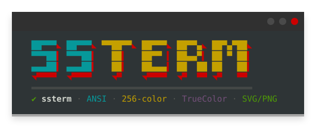
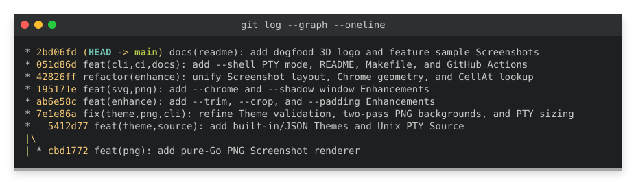
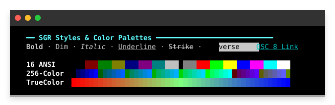
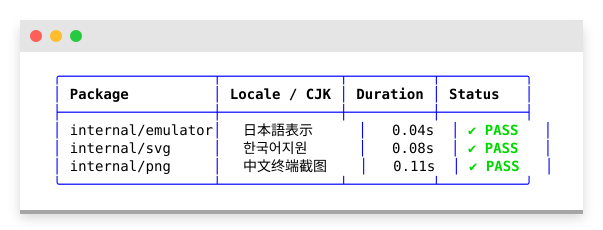
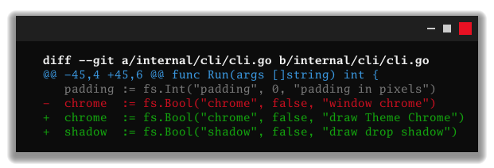

<div align="center">
  
</div>

# ssterm

`ssterm` is a self-contained Go CLI that turns terminal output into a **Faithful**, shareable **Screenshot** (SVG by default, or pure-Go PNG) of what a terminal would display.

It runs a real VT terminal emulator ([`charmbracelet/x/vt`](https://github.com/charmbracelet/x/tree/main/vt)) over a **Source** (either piped `stdin` or a command executed inside a pseudo-terminal), builds a 2D **Screen grid** of styled cells (and **Scrollback**), applies a **Theme**, and renders a crisp vector SVG or raster PNG—with zero headless browsers or external runtime dependencies.

---

## Sample Screenshots

### 1. Git Graph & Colored Output (`--theme dark --title "git log --graph --oneline" --shadow --padding 16`)
```bash
git -P log --graph --oneline --decorate -n 8 --color=always \
  | ssterm --theme dark --title "git log --graph --oneline" --shadow --padding 16 -o assets/sample-git-log.svg
```


### 2. SGR Styles, 16/256-Color, TrueColor & OSC 8 Links (`--theme iterm2`)
```bash
ssterm --theme iterm2 --chrome --shadow --padding 16 -o assets/sample-colors-attributes.svg < palette.ansi
```


### 3. Box-Drawing Tables & Wide CJK / Emoji Alignment (`--theme macos`)
```bash
ssterm --theme macos --chrome --shadow --padding 16 -o assets/sample-unicode-table.svg < table.ansi
```


### 4. Pure-Go PNG Output & Windows Terminal Chrome (`-o ...png --theme windows`)
```bash
git diff --color=always | ssterm --theme windows --chrome --shadow --padding 16 -o assets/sample-png-windows.png
```


---

## Features

- **Faithful Terminal Emulation**
  - **SGR Colors:** 16 ANSI colors, 256-color indexed palette (`38;5;N` / `48;5;N`), and 24-bit TrueColor (`38;2;R;G;B` / `48;2;R;G;B`).
  - **Text Attributes:** Bold (including Theme-controlled `bold_as_bright`), dim/faint, italic, underline, strikethrough, reverse video, and blink (rendered as static text).
  - **Cursor & Screen Control:** Carriage returns (`\r`), progress bars, cursor movement (`CUU`, `CUD`, `CUF`, `CUB`, `CUP`), line/screen erase (`EL`, `ED`), alternate screen (`?1049h`), and **Scrollback** preservation.
  - **Unicode & Box Drawing:** Wide CJK/emoji cells (2-column advance), combining marks, and column-aligned box-drawing glyphs (`┌─┐│└┘`) without horizontal drift.
  - **OSC 8 Hyperlinks:** Clickable `<a href="...">` links in SVG Screenshots.
- **Two Sources**
  - **Piped Source (`cmd | ssterm`):** Reads piped `stdin`, automatically fits the **Screen grid** to the content (unless `--cols` / `--rows` are set), and includes **Scrollback** by default.
  - **PTY Source (`ssterm -- cmd [args...]`):** Runs the command inside a real pseudo-terminal (`isatty` is true, so tools emit color and TUI layouts automatically), emulates at the controlling terminal's dimensions (or `--cols` / `--rows`), includes **Scrollback**, and auto-fits the rendered **Screen grid** to the non-blank cells on exit.
- **Dual Output Formats**
  - **SVG (default):** Written to `stdout` or `-o file.svg`. Uses run-length encoded `<text>` and `<tspan>` spans so text remains selectable and searchable.
  - **PNG (`-o file.png`):** Pure-Go rasterizer using embedded Go Mono (`gomono`) fonts with automatic Nerd Font / system monospace glyph fallback—no `cgo` required.
- **Pluggable Themes & User Defaults**
  - 6 built-in Themes (`dark`, `light`, `macos`, `iterm2`, `gnome`, `windows`), custom JSON Theme files via `--theme path/to/theme.json`, and persistent user defaults in `~/.config/ssterm/config.json`.
- **Opt-In Cosmetic Enhancements**
  - **Faithful** by default; opt into `--trim`, `--crop`, `--padding`, `--chrome`, `--title`, and `--shadow` when preparing documentation or social Screenshots.

---

## Installation

### Quick Install (`curl`)

Install the latest release (or pre-release) on Linux, macOS, or Windows (Git Bash / MSYS2):

```bash
curl -fsSL https://raw.githubusercontent.com/galihanggara68/ssterm/main/install.sh | sh
```

To install a specific version or into a custom directory (e.g. `~/.local/bin`):

```bash
curl -fsSL https://raw.githubusercontent.com/galihanggara68/ssterm/main/install.sh | VERSION=v0.1.0 INSTALL_DIR=~/.local/bin sh
```

### Build from source

Requires Go 1.25+:

```bash
git clone https://github.com/galihanggara68/ssterm.git
cd ssterm
go build -o ssterm ./cmd/ssterm
```

Or install directly into `$GOBIN`:

```bash
go install github.com/galihanggara68/ssterm/cmd/ssterm@latest
```

---

## Quick Start

### 1. Piped Source to SVG (`stdout` or file)

```bash
# Write SVG to stdout
printf "\033[1;32m✔ PASS\033[0m  internal/cli (0.23s)\n" | ssterm > pass.svg

# Write SVG directly to a file with -o
git diff --color=always | ssterm -o diff.svg
```

> **Why is my piped output black and white?**
> Most CLI tools (`git`, `ls`, `grep`, `ripgrep`) check whether `stdout` is a terminal (`isatty`) and disable ANSI colors when piped (`|`). To keep colors, either:
> 1. **Use PTY mode (`--`)** so `ssterm` runs the command inside a real pseudo-terminal:
>    ```bash
>    ssterm -o log.svg -- git -P log --graph
>    ```
> 2. **Force color output on the piped command** (e.g. `--color=always` or `-c color.ui=always`):
>    ```bash
>    git -P log --graph --color=always | ssterm -o log.svg
>    ```

### 2. Render directly to PNG

 Format is selected automatically from the `-o` file extension (`.svg` or `.png`):

```bash
printf "\033[31mError:\033[0m connection refused\n" | ssterm -o error.png
```

### 3. Run a command in a PTY (`--`)

Commands that check `isatty(1)` automatically enable colors and progress bars when run after `--` (`ssterm` also sets `TERM=xterm-256color`, `COLORTERM=truecolor`, `CLICOLOR_FORCE=1`, and `FORCE_COLOR=1`):

```bash
ssterm -o ls.svg -- ls --color=auto -la
ssterm -o test.png -- go test -v ./...

# Use --shell (-s) to run aliases or functions defined in ~/.bashrc or ~/.zshrc
ssterm -s -o status.svg -- my_shell_alias
```

### 4. Polished Documentation Screenshot

Combine a **Theme** with opt-in **Enhancements** (`--trim`, `--padding`, `--title` / `--chrome`, `--shadow`):

```bash
ssterm \
  --theme macos \
  --trim \
  --padding 16 \
  --title "git status -sb" \
  --shadow \
  -o showcase.svg \
  -- git status -sb
```

---

## Usage & Available Commands

```text
Usage:
  cmd | ssterm [flags]
  ssterm [flags] -- cmd [args...]
```

### Flags Reference

| Flag | Type | Default | Description |
| :--- | :--- | :--- | :--- |
| `-o <path>` | `string` | `""` (`stdout`) | Write the Screenshot to `<path>` instead of `stdout`. Extension selects format: `.svg` or `.png`. |
| `--theme <name\|path>` | `string` | `"dark"` | Built-in Theme name (`dark`, `light`, `macos`, `iterm2`, `gnome`, `windows`) or path to a `.json` Theme file. |
| `--cols <n>` | `int` | fit content | Screen grid width in columns (`> 0`). Wraps lines exceeding `<n>` columns and locks the rendered width. |
| `--rows <n>` | `int` | fit content | Screen grid height in rows (`> 0`). When explicitly set, renders only the visible Screen grid without Scrollback. |
| `--font <stack>` | `string` | `ui-monospace, SFMono-Regular, Menlo, Consolas, 'DejaVu Sans Mono', monospace` | CSS `font-family` stack emitted on the root `<g>` element in SVG Screenshots. |
| `--trim` | `bool` | `false` | Strip leading and trailing blank rows and columns around the Screen grid. |
| `--crop <spec>` | `string` | `""` | Crop the Screen grid to a 0-based cell rectangle (`COL,ROW,WxH`, `WxH+COL+ROW`, or `COL,ROW,W,H`). |
| `--padding <px>` | `int` | `0` | Add `<px>` pixels (`>= 0`) of Theme background around all four sides of the Screen grid. |
| `--chrome` | `bool` | `false` | Draw the Theme's window **Chrome** (title bar and control buttons) above the Screen grid. |
| `--title <text>` | `string` | `""` | Draw `<text>` centered in the Chrome title bar (automatically enables `--chrome` when non-empty). |
| `--shadow` | `bool` | `false` | Draw a soft drop shadow around the Screenshot window. |
| `-s`, `--shell` | `bool` | `false` | Run the PTY command (`--`) through `$SHELL -i -c` so aliases and functions from `.bashrc` / `.zshrc` are loaded. |
| `-v`, `--version` | — | — | Print `ssterm <version>` to `stdout` and exit `0`. |
| `-h`, `--help` | — | — | Print usage and flags to `stderr` and exit `0`. |

---

## Sizing & Scrollback Behavior

| Mode | Emulation Size | Rendered Size (`--cols` / `--rows` unset) | Scrollback Behavior |
| :--- | :--- | :--- | :--- |
| **Piped Source** (`cmd \| ssterm`) | Upper-bound fit estimate (or `--cols` / `--rows`). | Auto-fits the tightest bounding box of non-blank cells (`>= 1x1`). | **Included** above the active Screen grid unless `--rows` is explicitly set or the program exits on the alternate screen (`\x1b[?1049h`). |
| **PTY Source** (`ssterm -- cmd`) | Inherits controlling terminal size (`stdin`/`stdout`/`stderr`), falling back to `80x24` (or `--cols` / `--rows`). | Auto-fits the tightest bounding box of non-blank cells (`>= 1x1`). | **Included** above the active Screen grid unless `--rows` is explicitly set or the program exits on the alternate screen (`\x1b[?1049h`). |

---

## Themes & Configuration

### Built-in Themes

Pass any built-in name or alias (case-insensitive; spaces or hyphens accepted) to `--theme`:

| Canonical Name | Accepted Aliases | Background | Foreground | Bold as Bright | Chrome Layout |
| :--- | :--- | :--- | :--- | :--- | :--- |
| `dark` *(default)* | `default-dark`, `default dark` | `#1d1f21` | `#c5c8c6` | `true` | `macos` (left traffic lights) |
| `light` | `default-light`, `default light` | `#ffffff` | `#4d4d4c` | `false` | `macos` (left traffic lights) |
| `macos` | `macos-terminal`, `macOS Terminal` | `#ffffff` | `#000000` | `true` | `macos` (left traffic lights) |
| `iterm2` | `iTerm2` | `#000000` | `#c7c7c7` | `true` | `macos` (left traffic lights) |
| `gnome` | `gnome-terminal`, `GNOME Terminal` | `#2e3436` | `#d3d7cf` | `false` | `gnome` (right circular buttons) |
| `windows` | `windows-terminal`, `Windows Terminal` | `#0c0c0c` | `#cccccc` | `true` | `windows` (right minimize/maximize/close) |

### Custom JSON Theme File

When `--theme` ends with `.json` or contains a path separator (`/` or `\`), `ssterm` loads and validates a JSON Theme file:

```bash
ssterm --theme ./dracula.json --chrome -o out.svg < session.ansi
```

#### JSON Schema

```json
{
  "name": "dracula",
  "foreground": "#f8f8f2",
  "background": "#282a36",
  "bold_as_bright": true,
  "ansi": [
    "#21222c", "#ff5555", "#50fa7b", "#f1fa8c",
    "#bd93f9", "#ff79c6", "#8be9fd", "#f8f8f2",
    "#6272a4", "#ff6e6e", "#69ff94", "#ffffa5",
    "#d6acff", "#ff92df", "#a4ffff", "#ffffff"
  ],
  "chrome": {
    "layout": "macos",
    "background": "#191a21",
    "foreground": "#f8f8f2",
    "buttons": ["#ff5555", "#f1fa8c", "#50fa7b"]
  }
}
```

#### Schema Validation Rules
- **`foreground`** *(required)*: `#RRGGBB` hex color string.
- **`background`** *(required)*: `#RRGGBB` hex color string.
- **`ansi`** *(required)*: Array of exactly 16 `#RRGGBB` hex color strings (indices `0–7` standard, `8–15` bright).
- **`name`** *(optional)*: String; defaults to the file basename without extension.
- **`bold_as_bright`** *(optional)*: Boolean (`false` by default); when `true`, bold text using standard ANSI colors `0–7` uses bright colors `8–15`.
- **`chrome`** *(optional)*: Object customizing window **Chrome** when `--chrome` or `--title` is passed:
  - `layout`: `"macos"`, `"gnome"`, or `"windows"` (defaults to `"macos"`).
  - `background`: `#RRGGBB` title bar fill color.
  - `foreground`: `#RRGGBB` title bar foreground color (defaults to the Theme's `foreground`).
  - `buttons`: Array of 3 `#RRGGBB` button colors.
- Unknown fields, `null` values, or malformed hex strings fail immediately with exit code `2` and a descriptive error on `stderr`.

### User Configuration File (`config.json`)

To avoid repeating your preferred flags on every invocation, create `$XDG_CONFIG_HOME/ssterm/config.json` (or `~/.config/ssterm/config.json` on Linux/macOS, `%AppData%\ssterm\config.json` on Windows), or point `$SSTERM_CONFIG` to a custom file path:

```json
{
  "theme": "macos",
  "font": "JetBrains Mono, ui-monospace, monospace",
  "padding": 16,
  "trim": true,
  "chrome": true,
  "shadow": true,
  "shell": false
}
```

- **Precedence:** Any flag explicitly passed on the command line (including `--chrome=false`, `--shadow=false`, `--trim=false`, or `--padding 0`) overrides `config.json`.
- **Validation:** Missing default config files are silently ignored. If `$SSTERM_CONFIG` points to a missing file, or if `config.json` contains unknown keys, `null` values, or invalid types/values, `ssterm` prints an error to `stderr` and exits `2`.

---

## Cosmetic Enhancements

By default, `ssterm` produces a **Faithful** Screenshot: the exact **Screen grid** dimensions (`cols * 9px` by `rows * 18px`) with no extra margins, Chrome, or shadows.

Enhancements compose in a fixed, predictable pipeline:

1. **`--trim`:** Removes leading and trailing blank rows and columns around the active Screen grid (preserving at least a `1x1` cell when all cells are blank). A cell with a non-default background color, reverse video, underline, strikethrough, or hyperlink is treated as non-blank.
2. **`--crop <spec>`:** Extracts a 0-based rectangular sub-grid in cell coordinates. Supported formats:
   - `COL,ROW,WxH` (e.g. `--crop 2,1,40x10`)
   - `WxH+COL+ROW` (e.g. `--crop 40x10+2+1`)
   - `COL,ROW,W,H` (e.g. `--crop 2,1,40,10`)
   - Wide 2-column glyphs straddling a crop edge are cleanly replaced with a 1-column space preserving the cell's styling.
3. **`--padding <px>`:** Expands the Screen grid background by `<px>` pixels on all four sides (`width + 2*px`, `height + 2*px`) and offsets cell rendering by `(px, px)`.
4. **`--chrome` & `--title <text>`:** Adds a `32px`-tall window title bar above the (optionally padded) Screen grid body using the active Theme's Chrome layout (`macos`, `gnome`, or `windows`). Passing a non-empty `--title` automatically enables Chrome, horizontally centers the title in `chrome.foreground`, and truncates long titles with `…` inside the safe zone between the window buttons so narrow Screenshots never widen.
5. **`--shadow`:** Surrounds the window (Chrome + Screen grid body) with a `20px` outer margin and renders a translucent drop shadow (`<feDropShadow>` in SVG; alpha-blended falloff in PNG).

---

## Exit Codes & Platform Support

| Exit Code | Meaning |
| :--- | :--- |
| `0` | Screenshot rendered and written, or `--help` / `--version` displayed. |
| `1` | Runtime error (e.g., empty piped `stdin`, file write error, or unsupported PTY mode on Windows). |
| `2` | CLI usage or validation error (unknown flag, invalid `--cols`/`--rows`/`--padding`/`--crop`, unknown `--theme`, invalid JSON Theme or `config.json` file, unsupported `-o` extension, or missing command after `--`). |
| `<child code>` | In PTY mode (`ssterm -- cmd`), `ssterm` writes the Screenshot of the command's output and exits with the child command's exit code (or exits `1` without writing a Screenshot if the command fails to start). |

### Platform Support

- **Linux & macOS:** Full support for both Piped Source (`cmd | ssterm`) and PTY Source (`ssterm -- cmd`).
- **Windows:** Full support for Piped Source (`cmd | ssterm`) for both SVG and PNG output. PTY mode (`ssterm -- cmd`) reports `ssterm: PTY mode (--) is not supported on Windows; pipe output to ssterm instead` and exits non-zero.

---

## Development

### Quality Gates & Makefile

```bash
make check        # Run fmt-check, go build, go vet, and go test
make build        # Compile ./ssterm binary
make install      # Install ssterm into $GOBIN / $GOPATH/bin
make test         # Run all tests
make test-race    # Run all tests with -race
make golden       # Regenerate golden SVG fixtures in internal/cli/testdata/
make cross-build  # Verify Linux, macOS, and Windows builds
make clean        # Remove compiled binaries
make help         # List all Make targets
```

---

## License

Released under the [MIT License](LICENSE).
