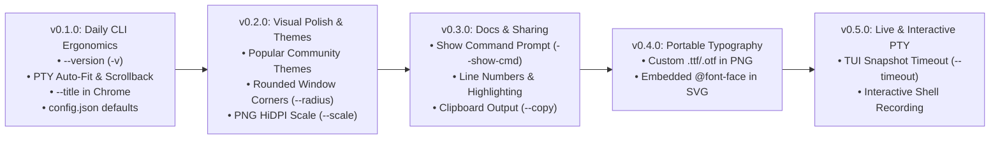

# ssterm Roadmap

`ssterm` follows a small-slice minor release cadence (`0.y.0`) so each version ships a cohesive, well-tested set of improvements without scope bloat.

---

## `v0.1.0` — Daily CLI Ergonomics *(Current MVP Slice)*

- **Version Inspection (`--version` / `-v`):** Print `ssterm <version>` (`ssterm v0.1.0` in tagged releases via `-ldflags`, `ssterm dev` in local builds) and exit `0`.
- **PTY Auto-Fit & Scrollback Parity:** Emulate PTY commands at terminal dimensions (`TermSize` or `--cols`/`--rows`, `80x24` fallback), then include **Scrollback** and auto-fit the rendered **Screen grid** to non-blank bounds (`usedBounds`) whenever `--cols`/`--rows` are not explicitly passed.
- **Window Title in Chrome (`--title <text>`):** Render `<text>` centered in the **Chrome** title bar using the Theme's `chrome.foreground` color, automatically enable **Chrome** when `--title` is non-empty, and truncate with `…` inside the safe zone between Chrome buttons on narrow **Screenshots**.
- **User Defaults Config (`config.json`):** Load persistent defaults (`theme`, `font`, `padding`, `trim`, `chrome`, `shadow`, `shell`) from `$SSTERM_CONFIG` or `$XDG_CONFIG_HOME/ssterm/config.json` (`~/.config/ssterm/config.json`), with explicit CLI flags always taking precedence.

---

## `v0.2.0` — Visual Polish & Community Themes

- **Popular Community Themes Built-In:** Add `dracula`, `catppuccin-mocha`, `catppuccin-latte`, `tokyo-night`, `nord`, and `gruvbox-dark` as built-in **Themes**.
- **Rounded Window Corners (`--radius <px>`):** Support rounded window corners when `--chrome` or `--shadow` is active (`rx` / `<clipPath>` in SVG and anti-aliased corner masking in PNG).
- **Retina / HiDPI Scale Factor for PNG (`--scale <n>`):** Render PNG fonts and layout geometry at `2x` / `3x` resolution for crisp raster **Screenshots** on HiDPI/4K displays.

---

## `v0.3.0` — Documentation Ergonomics & Sharing

- **Show Command Prompt Header (`--show-cmd` / `--prompt`):** Optionally prepend `$ <command>` at the top of the **Screen grid** so readers see both the command executed and its output.
- **Line Numbers & Line Highlighting (`--line-numbers`, `--highlight <ranges>`):** Render gutter line numbers and row highlight bands (e.g. `--highlight 3,5-8`) for tutorials and code walkthroughs.
- **Clipboard Output (`--copy` / `-c`):** Copy the rendered **Screenshot** directly to the system clipboard (`wl-copy`/`xclip` on Linux, `pbcopy`/`osascript` on macOS, Windows clipboard).

---

## `v0.4.0` — Portable Typography

- **Custom `.ttf`/`.otf` Font Loading in PNG:** Allow `--font` to accept a `.ttf`/`.otf` file path or installed system font family name as the primary font in PNG rendering.
- **Embedded `@font-face` in SVG (`--embed-font`):** Inline font subsets or WOFF2/TTF data into SVG **Screenshots** so Nerd Font icons and custom typefaces render identically on machines without those fonts installed.

---

## `v0.5.0` — Live TUI & Interactive Sessions

- **Timeout / Snapshot for Long-Running TUI Apps (`--timeout <duration>`):** Run non-terminating TUIs (`htop`, `btop`, `top`, `watch`) in a PTY for `<duration>`, snapshot the active **Screen grid**, and cleanly terminate the child process.
- **Interactive Shell Recording (`ssterm record`):** Spawn an interactive shell session where users can run a sequence of commands and render the session into a **Screenshot** upon `exit`.
